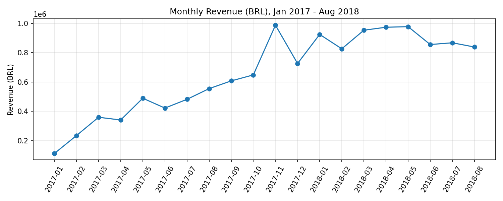
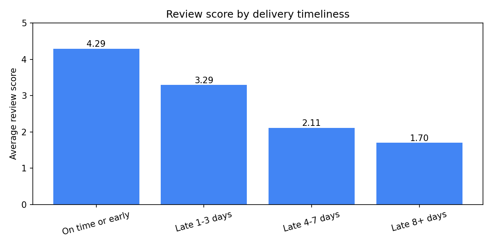

# Olist SQL Analysis: 8 Business Questions

SQL analysis of the Olist Brazilian e-commerce dataset. The 9 CSV files are loaded into a SQLite database, and eight business questions are answered with SQL: CTEs, window functions (`LAG`, `RANK`, running totals), views, conditional aggregation, and multi-table joins.

This is the SQL companion to the [Olist dashboard project](https://github.com/nalendra-wp/olist-ecommerce-dashboard).

**Scope:** delivered orders purchased between Jan 2017 and Aug 2018 (months with complete data): **109,872 items, 96,203 orders, R$ 13.18M revenue**. Q7 covers all orders in the payments table.



## Key findings

| # | Question | Answer |
|---|---|---|
| 1 | Revenue growth | Monthly revenue grew from R$ 112K (Jan 2017) to a peak of **R$ 988K in Nov 2017** (+52% vs. October), dipped in Dec 2017, then held at R$ 830K–980K per month through Aug 2018 |
| 2 | Revenue by category | The top 3 categories (`health_beauty` 9.3%, `watches_gifts` 8.8%, `bed_bath_table` 7.8%) bring 25.9% of revenue; the top 10 bring 62.5% |
| 3 | Top sellers by state | The top seller in São Paulo earned **R$ 227K from 1,124 orders**, the highest among the five largest seller states; the top sellers in the other four states earned R$ 59K–121K |
| 4 | Late deliveries by state | Among states with 500+ orders, **Maranhão (17.5%)**, Ceará (13.8%), Bahia (12.2%), and Rio de Janeiro (12.1%) have the highest share of late orders |
| 5 | Lateness vs. reviews | Reviews fall steadily with delay: **4.29** on time, 3.29 (1–3 days late), 2.11 (4–7 days), **1.70** (8+ days). About 6.7% of reviewed orders arrive late |
| 6 | Repeat customers | Only **3.0%** of customers (2,789 of 93,096) bought more than once |
| 7 | Payment methods | Credit card is used in 76.9% of orders (3.5 installments on average), boleto in 19.9%, voucher 3.9%, debit card 1.5% |
| 8 | Cumulative revenue | Revenue crossed R$ 5M in Nov 2017 and R$ 10M in May 2018, reaching R$ 13.18M by Aug 2018. About 55% of it came in the last 8 months (Jan–Aug 2018) |



### Notes on the findings
- Late delivery and low reviews are **associated**. The data cannot show that lateness causes low reviews.
- Q4 ranks states by the share of orders that arrive *later than promised*, which is different from ranking by average delivery days (as in the dashboard project). A state can be slow and still moderately late if its delivery estimates already allow for the distance.
- Repeat purchases are rare in this dataset (Q6): 97% of customers bought only once.

## SQL techniques used

| Technique | Where |
|---|---|
| Views to reuse definitions (`delivered_orders`, `delivered_items`, `order_reviews_avg`) | all questions |
| CTEs | Q1, Q2, Q3, Q6, Q8 |
| `LAG` (month-over-month growth) | Q1 |
| `SUM() OVER` (share, cumulative share, running total) | Q2, Q5, Q8 |
| `RANK() OVER (PARTITION BY ...)` | Q3 |
| Conditional aggregation (`CASE`) and `HAVING` | Q4, Q5, Q6 |
| Scalar subquery | Q7 |
| Multi-table `JOIN` | Q2, Q3, and inside the views |

## How the data is prepared

- 9 CSV files are loaded into SQLite, with indexes on the join keys.
- Reviews are averaged **per order** first, because some orders have several reviews and joining them directly would duplicate rows.
- `delivered_orders` (one row per order) and `delivered_items` (one row per item) filter to delivered orders with a delivery date, purchased Jan 2017 – Aug 2018.
- **Validation:** the views return 109,872 items, 96,203 orders, and R$ 13,179,777.95 in revenue, matching the Python + Looker Studio project on the same data.
- **Late** = delivered at least one full day after the estimated delivery date.

## Limitations

- Q5 and the review averages use only orders that have a review (95,560 of 96,203 orders).
- Q3 shows only the five largest seller states, with seller IDs shortened (they are already anonymized in the dataset).
- Q6 counts repeat purchases only within the study window, so the true repeat rate may be slightly higher.
- Q7 is computed on all orders, not only the study window. Percentages add up to slightly more than 100% because an order can use several payment types, and 3 orders have an undefined payment type.
- Revenue is item price in Brazilian reais (BRL), excluding freight.

## Data

- **Source:** [Brazilian E-Commerce Public Dataset by Olist](https://www.kaggle.com/datasets/olistbr/brazilian-ecommerce) on Kaggle
- **License:** CC BY-NC-SA 4.0 (attribution, non-commercial, share-alike)
- The data is **not redistributed** in this repository.

## Repository structure

```
├── sql/         olist_queries.sql  (all views and the 8 queries)
├── notebooks/   olist_sql_analysis.ipynb
├── images/      result figures
└── README.md
```

## How to run

1. Download the dataset from Kaggle and unzip the 9 CSV files.
2. Open `notebooks/olist_sql_analysis.ipynb` in Google Colab and upload the CSV files to the session.
3. Run all cells (Runtime → Run all). The notebook builds `olist.db`, creates the views, and runs the queries.
4. To run the SQL by itself, load the CSVs into SQLite tables named as in the notebook, then execute `sql/olist_queries.sql`.

## Tools

SQL (SQLite) · Python · pandas · matplotlib · Google Colab

## Author

**Nalendra Whisnu Pinilih**
Information Systems graduate, Universitas Dian Nuswantoro · BNSP-certified Associate Data Scientist
[GitHub](https://github.com/nalendra-wp) · nalendrawp@gmail.com
